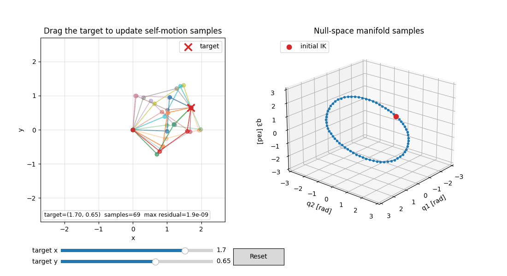
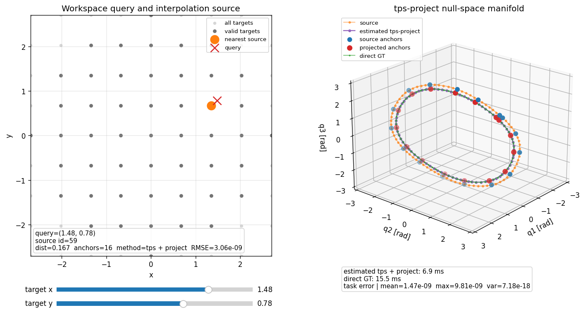
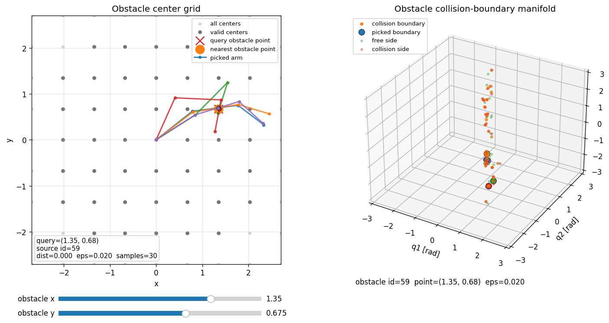

# Null-space Manifold & GPIS Demo

3自由度平面アーム（Planar 3R）を使い、手先位置を満たす関節姿勢の集合、
そのデータベース化・補間、点障害物との接触近傍を可視化する研究用Python実装です。
手先目標と障害物位置を動かし、作業空間と関節空間を並べて確認できます。

**研究用のプロトタイプです。衝突回避の安全性や多様体の網羅性は保証しません。**
障害物からの斥力と目標多様体への引力を統合した経路生成は、まだ実装していません。

## 動作イメージ

### 手先目標と零空間多様体

石垣氏らの[零空間多様体の暗黙表現に関する論文](https://roboticsproceedings.org/rss22/p187.html)を参考に、
ヤコビアン誘導サンプリングとGPISによる解多様体表現を平面3Rアームに実装しています。
以下のGIFは、目標位置を満たす姿勢集合のサンプリングを示します。GPISの場は含みません。



左の赤い×が手先目標です。同じ目標に到達する複数の姿勢を重ねて描き、右に対応する
関節角度の集合を表示しています。目標が動くと、姿勢と多様体の形が変化します。
GIFは目標軌道を自動入力した再生用アニメーションで、実時間性能の記録ではありません。
[静止画を見る](docs/images/self_motion.png) / 実行: `python interactive_demo.py`

### DBからの補間と再射影

**目的:** 事前計算した多様体を再利用し、目標変更時の計算量を削減することを目指します。
論文のサンプリング手法を基礎に、本リポジトリで追加した実験機能です。

**手法:** 作業空間グリッドごとの多様体をHDF5に保存し、近傍検索で最近傍の1本を取得します。
参照多様体上のアンカーを新しい目標へ射影し、その変位をGaussian RBFまたはTPSで補間します。
補間のみでは手先位置制約を満たす保証がないため、全推定点をGauss–Newtonで再射影するモードも実装しています。



左のオレンジ点が参照するDB目標、赤い×が要求目標です。右では参照多様体（オレンジ）、
TPS＋全点射影（紫）、直接サンプリング（緑）を比較できます。

**予備評価の結果:** 目標 `(1.48, 0.78)`、9×9グリッド、アンカー16点の条件では、
**TPS＋全点再射影で最大手先誤差を約 `9.8e-9` に抑えながら、直接サンプリングに対して約2.2倍の高速化**が得られました。
処理時間は直接サンプリングの約15.5 msに対し約6.9 msで、約55%の短縮に相当します。
この結果は、事前計算した多様体の再利用により、手先位置精度と更新速度を両立できる可能性を示しています。

測定値は掲載図の単一条件・単回実行に基づき、同一サンプル数・反復計測による比較ではありません。
推定時間にはアンカー射影・TPS補間・全点再射影を含み、DBの事前生成・検索と描画は含みません。

**評価範囲:** 手先誤差は再射影後の値です。補間単体の精度、多様体全体の形状・被覆率、
複数目標に対する速度優位性は未評価です。

### 障害物境界とアーム姿勢の対応

**目的:** 目標多様体への引力と障害物境界からの斥力を同じ関節空間で扱うための、
データ生成・参照基盤を検討する探索的な試作です。ポテンシャル場による経路生成は未実装です。

**手法:** 点障害物とリンク中心線の最短距離を用い、距離がε以下・εより大きい姿勢を
ランダムサンプルから選びます。その姿勢対を二分探索して距離εの境界を求め、障害物位置ごとに保存します。
リンクの太さを考慮する従来の衝突データセットとは別のモデルです。



**実行例:** ランダム姿勢8,000点から、障害物位置 `(1.35, 0.675)` に対して30点の境界サンプルを生成しています。
右の境界点と左のアーム姿勢は同色で対応します。距離はε（図では0.02）付近であり、厳密な接触姿勢ではありません。

**評価範囲:** 生成・保存・参照・描画と、小規模テストでの境界距離の確認に限ります。
境界の網羅性、DBの有用性、回避性能は未評価です。障害物位置の補間には対応していません。

図はすべて本リポジトリの実装で生成しており、論文の図の転載ではありません。

## 機能

| 機能 | 内容 |
| --- | --- |
| 零空間サンプリング | ヤコビアンの零空間方向へ移動し、Gauss–Newtonで手先位置制約へ射影 |
| GPIS | サンプルから暗黙関数と近似距離場を構築する静的デモ |
| 零空間DB | 作業空間グリッドごとのサンプルを単一HDF5へ保存・追加 |
| 近傍検索 | Workspace Spatial Hashで近傍セル内の目標を検索 |
| 補間 | 最近傍の多様体をRBFまたはTPSで変形、必要に応じて全点を再射影 |
| 障害物DB | 点障害物とリンク線分の距離がεとなる境界姿勢を保存 |
| ビューア | 目標・障害物の操作、補間誤差・処理時間、対応するアーム姿勢の表示 |

## セットアップ

Python **3.10以上**が必要です。GUI表示にはデスクトップ環境とMatplotlibの
GUIバックエンド（Tkなど）が必要です。コマンドはリポジトリ直下で実行してください。

```bash
python -m venv .venv
```

仮想環境を有効化します。

```powershell
# Windows PowerShell
.venv\Scripts\Activate.ps1
```

```bash
# macOS / Linux
source .venv/bin/activate
```

```bash
python -m pip install -r requirements.txt
```

PowerShellで有効化が許可されない場合は、以降の `python` を
`.venv\Scripts\python.exe` に置き換えて実行できます。
依存バージョンは固定していないため、厳密な再現には使用環境の記録が必要です。

## 最初に試す

DBを作らず、手先目標の変更に応じて直接サンプリングします。

```bash
python interactive_demo.py
```

左の赤い目標点をドラッグ、またはスライダーで動かすと、アーム姿勢と右側の多様体が更新されます。
静的なGPISデモは次で実行できます。

```bash
python main.py
```

`outputs/` に `arm_self_motion.png`、`manifold_samples_3d.png`、
`gpis_distance_slice.png` と、サンプル・射影軌道のNumPy配列を保存します。
生成されたDBや画像はGit管理から除外しています。
ただしREADME掲載用の `docs/images/` はGit管理の対象です。

## DBを使う

### 1. 零空間DBを生成

```bash
python scripts/build_database.py --output data/nullspace_database.h5 --grid-x 20 --grid-y 20 --max-samples 220
python scripts/inspect_database.py --database data/nullspace_database.h5 --target 1.3 0.7 --k 3
```

まず小さく試す場合は `--grid-x 5 --grid-y 5 --max-samples 30` を指定してください。
グリッド点数やサンプル数を増やすと生成時間・ファイルサイズも増えます。

```bash
python scripts/view_database_query.py --database data/nullspace_database.h5 -k 3
python scripts/view_database_interpolation.py --database data/nullspace_database.h5 --method tps-project --show-gt
```

`-k` は比較表示する近傍多様体の数です。補間に使うのは最近傍の1本だけです。
左右で参照目標と多様体の色が対応します。検索範囲は `--radius-cells` で指定します。

既存DBに未登録の目標を追加する場合:

```bash
python scripts/build_database.py --output data/nullspace_database.h5 --grid-x 40 --grid-y 40 --append
```

同じ位置は失敗済みの目標も含めてスキップされ、再計算されません。
追加時には既存の作業空間・ハッシュ分割を維持します。ファイル全体を書き直す実装のため、
大きなDBではメモリとバックアップに注意してください。`--append` なしでは上書きされます。

### 2. 同じグリッドに障害物DBを生成

```bash
python scripts/build_obstacle_manifold_database.py --nullspace-database data/nullspace_database.h5 --output data/obstacle_manifold_database.h5 --contact-epsilon 0.02
python scripts/view_obstacle_manifold_database.py --database data/obstacle_manifold_database.h5 --arm-samples 6
```

指定した零空間DBが存在しない場合はエラーになります。
独立したグリッドを使う場合は `--no-nullspace-grid --grid-x 20 --grid-y 20` を指定してください。
障害物DBは追加保存に対応しておらず、同じ出力先は上書きされます。

境界から選んだ関節姿勢と、左側のアームを同色で表示します。
姿勢はクリックした位置そのものではなく、**最近傍の有効なDB障害物位置**に対応します。
障害物位置の補間は行いません。障害物DBの検索は全有効中心との距離比較です。

現在の境界の定義は `min_link distance(point, segment(q)) = contact_epsilon` です。
`collision side` は距離がε以下、`free side` はεより大きい元サンプルを意味します。
**距離ゼロの厳密な接触姿勢ではありません。** ランダム姿勢から両側の点を選び二分探索するため、
有限サンプルでは境界の取りこぼしがあります。εをゼロにすると通常は接触側を収集できません。

### 3. 同時表示

```bash
python scripts/view_combined_manifolds.py --nullspace-database data/nullspace_database.h5 --obstacle-database data/obstacle_manifold_database.h5 --show-gt
```

- 左パネルの左クリック・ドラッグ: 手先目標を変更
- 左パネルの右クリック・ドラッグ: 障害物位置を変更
- 右パネル: 推定零空間多様体、参照多様体、障害物境界を表示

## 補間と評価指標

`--method` は `rbf`、`rbf-project`、`tps`、`tps-project`（既定）です。
参照多様体のアンカーを目標手先位置へ射影し、その変位を補間します。
`*-project` は補間後の**全サンプル**にもGauss–Newton射影を行います。
TPSはラップした角度距離に `r² log(r)` カーネルとアフィン項を使う実験的実装です。

表示する誤差は、各推定姿勢 `q_i` についての `||FK(q_i) - target||₂` の平均・最大・分散です。
Direct GTとの関節角度差ではなく、全点再射影後の小さい誤差も補間単体の精度を意味しません。
表示名 `direct GT` は直接サンプリングした比較用データであり、厳密解や全成分の列挙ではありません。

推定時間にはアンカー射影・補間・有効時の全点再射影が含まれ、DB検索・描画は含まれません。
GT時間は直接サンプリングの時間です。サンプル数が異なり得るため、表示値だけで公平な速度比較はできません。

## モデルと制約

- リンク長は既定で `(1.0, 1.0, 0.7)`。長さの単位は任意ですが、位置・距離・εで統一してください。
- 零空間側の角度は `[-π, π)` にラップします。物理的な関節ストッパーを実装したものではありません。
- 衝突用モデルのサンプリング範囲は各関節 `[-π, π]`。±πをまたぐ描画に長い線が出ることがあります。
- 零空間探索は1つの初期解からの追跡です。非連結成分の網羅、特異点付近の安定性、射影の収束は保証しません。
- ハッシュ検索の最近傍は指定した近傍セル内に限定されます。候補がなければ `--radius-cells` を増やしてください。
- 障害物DBは零空間DBの有効目標マスクも引き継ぎます。境界サンプルがない中心は参照候補になりません。
- 点障害物DBと、リンク半径を考慮する従来の衝突データセットは別形式です。旧障害物DBは再生成してください。
- 太さのある実機の安全性は、点・線分モデルへの斥力だけでは保証されません。

## コード構成

| パス | 役割 |
| --- | --- |
| `planar_arm.py`, `sampler.py` | 手先FK・ヤコビアン、射影、零空間探索 |
| `gpis.py`, `visualize.py`, `main.py` | GPISと静的デモ |
| `database.py`, `deformation.py` | HDF5の構築・検索、RBF/TPS変形 |
| `interactive_demo.py`, `viewer_utils.py` | 直接サンプリングGUI、共通配色 |
| `robot/` | 全関節位置を返すFKと衝突幾何 |
| `obstacle_database/` | 境界探索、障害物DB、衝突用空間ハッシュ |
| `scripts/` | DB生成・検証・対話ビューアのCLI |
| `tests/` | 数値処理・DB・ビューアの回帰テスト |

`PlanarArm3DOF.forward_kinematics` は手先の `(2,)`、
`Planar3RRobot.forward_kinematics` は基部を含む全関節の `(4, 2)` を返します。

## 開発とテスト

```bash
python -m unittest discover -s tests -v
```

テスト用DBは一時ディレクトリに生成します。GUIテストはAggバックエンドを使用し、
ウィンドウを開きません。GitHub Actionsでも同じテストを実行します。
GUIが開かない場合はTkなどのGUIバックエンドを確認してください。
データが見つからない場合は、DB生成コマンドとカレントディレクトリを確認してください。

## 詳細資料

- [零空間DBと補間](DATABASE.md)
- [障害物DB・従来の衝突データセット](COLLISION_DATABASE.md)
- [直接サンプリングGUI](INTERACTIVE.md)
- [開発・変更時の確認事項](CONTRIBUTING.md)

## 参考論文

Taiki Ishigaki, Teresa Vidal-Calleja, Ko Ayusawa, Eiichi Yoshida.
**Implicit Null-space Manifold Generation for Redundant Robotic Systems.**
*Robotics: Science and Systems (RSS)*, 2026.

[公式論文ページ](https://roboticsproceedings.org/rss22/p187.html) ·
[DOI](https://doi.org/10.15607/RSS.2026.XXII.187) ·
[arXiv](https://arxiv.org/abs/2605.25770) ·
[PDF](https://arxiv.org/pdf/2605.25770)

本実装は、ヤコビアン誘導サンプリングとGPISによる解多様体表現を学習・実験するための
簡略実装です。論文の公式実装や完全再現ではありません。
DBを使ったTPS変形・全点再射影は、本プロジェクトで追加した実験です。
障害物データ生成の参考文献は未特定です。この機能について特定論文の再現や手法の新規性は主張しません。

<details>
<summary>論文のBibTeX</summary>

```bibtex
@inproceedings{IshigakiT-RSS-26,
  author = {Taiki Ishigaki and Teresa Vidal-Calleja and Ko Ayusawa and Eiichi Yoshida},
  title = {Implicit Null-space Manifold Generation for Redundant Robotic Systems},
  booktitle = {Proceedings of Robotics: Science and Systems},
  year = {2026},
  address = {Sydney, Australia},
  month = {July},
  doi = {10.15607/RSS.2026.XXII.187}
}
```

</details>

## README用画像の再生成

```bash
python scripts/render_readme_media.py
```

既存のビューアと固定seedの一時DBから、`docs/images/` にPNGとGIFを生成します。
GUI・外部動画エンコーダーは不要です。PillowでGIFを保存します。
通常の `data/` 内のDBは変更しません。再生成時は同名の掲載画像を上書きします。

## ライセンス

[MIT License](LICENSE)。コード・ドキュメント・本リポジトリで生成した掲載画像を対象とします。
依存ライブラリおよび参照論文には、それぞれのライセンス・利用条件が適用されます。
